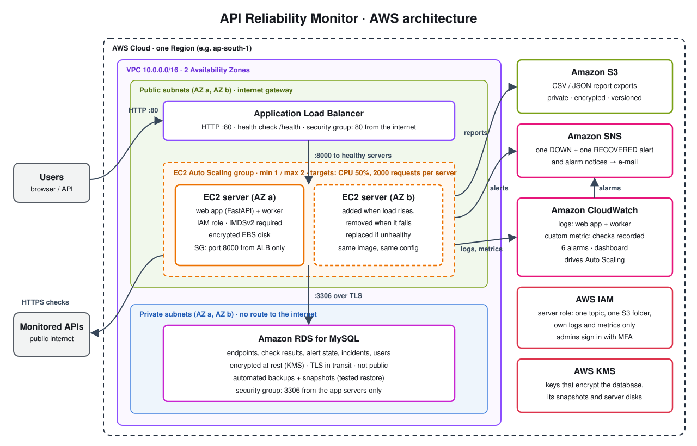

# 📡 API Reliability Monitor

A cloud-native service that checks your APIs on a schedule, records availability and response time, and sends **one alert when an API goes down and one when it recovers**, deployable to AWS with a single CloudFormation command.

      

## What it does

Apps depend on payment, login and third-party APIs. When one of them fails or slows down, nobody notices until users complain. This service watches those APIs continuously, keeps their history, and notifies you after a configurable number of consecutive failures.

- **Scheduled checks**: each endpoint on its own interval, with status code, response time and error type recorded
- **One alert per outage**: a DOWN alert after N consecutive failures and one RECOVERED notice, never duplicates
- **Dashboard and reports**: live status, incident log, availability %, p95 latency, CSV/JSON export
- **Roles**: `admin` manages endpoints, `viewer` is read-only
- **SSRF protection**: refuses private, loopback and cloud-metadata addresses, re-checked at connection time
- **Scales out safely**: any number of servers can run the worker without checking the same endpoint twice

## Architecture on AWS



1. Users reach an **Application Load Balancer**, which forwards only to servers that pass the `/health` check.
2. An **EC2 Auto Scaling group** runs the web app and the worker on every server, adding a server when CPU or request load rises and replacing unhealthy ones.
3. The worker claims due endpoints from **Amazon RDS (MySQL)**, checks them over HTTPS and records each result.
4. State changes trigger **one** alert through **Amazon SNS** (e-mail); report exports are written to **Amazon S3**.
5. **CloudWatch** collects logs and metrics, drives the scaling policies and raises alarms through SNS.

| Service | Role here |
|---|---|
| VPC, subnets, security groups | Network across 2 Availability Zones; the internet reaches only the load balancer, servers accept only the load balancer, the database accepts only the servers |
| Application Load Balancer | Single entry point, health checks, spreads traffic |
| EC2 + Auto Scaling | Servers from a launch template; min 1 / max 2, CPU and request-count target tracking; rolling updates |
| RDS for MySQL | Private, encrypted (KMS), TLS connections, automated backups |
| S3 | Report exports: private, encrypted, versioned |
| SNS | DOWN / RECOVERED alerts and alarm notifications by e-mail |
| CloudWatch | Log groups for web and worker, custom "checks recorded" metric, 6 alarms, a dashboard |
| IAM | Server role limited to one topic, one S3 folder, its own logs and metrics; IMDSv2 required |

**Measured on the live deployment:** scaled from 1 to 2 servers under load and back; 0 duplicate checks with 2 servers running; rolling update with no failed health checks; database restored from a snapshot in 8.2 minutes with all data intact.

## Run it locally (free)

With [Docker](https://docs.docker.com/get-docker/), one command starts MySQL, the web app, the worker and a switchable mock API:

```bash
docker compose up --build
```

Open <http://localhost:8000> and sign in with **`admin` / `Admin@123`** (or `viewer` / `Viewer@123`). These demo logins are for local use only.

Try an outage. About 45 seconds after switching the mock down, one alert appears in the worker log and under *Recent incidents*; switching it up sends one recovery notice:

```bash
curl -X POST "http://localhost:9100/__mode?value=down"
curl -X POST "http://localhost:9100/__mode?value=up"
```

Stop with `docker compose down` (add `-v` to delete the local database).

<details>
<summary>Without Docker (Python 3.12+ and a local MySQL 8.0.16+)</summary>

```bash
python -m venv .venv
source .venv/bin/activate              # Windows: .venv\Scripts\activate
pip install -r requirements.txt
cp .env.example .env                   # Windows: copy; then set DB_USER, DB_PASSWORD, SECRET_KEY
python scripts/init_db.py --seed       # database, tables, demo logins and endpoints

python tests/mock_server.py --port 9100    # terminal 1: switchable fake API
uvicorn app.main:app --reload              # terminal 2: web app -> http://127.0.0.1:8000
python -m app.worker                       # terminal 3: the monitoring worker
```

Set `RUN_WORKER_IN_API=true` to run the worker inside the web process instead.
</details>

## Deploy it on AWS

> **Cost warning.** This creates billable resources in *your* AWS account: a load balancer, an RDS database, EC2 servers and their public IPs (very roughly USD 40–50 a month, about USD 1.5 a day, at on-demand prices; check the [AWS Pricing Calculator](https://calculator.aws/)). **Delete the stack when you are done:**
> `aws cloudformation delete-stack --stack-name api-monitor`

**You need:** an AWS account and the [AWS CLI](https://aws.amazon.com/cli/) signed in with permission to create the resources above. Use a region with at least two Availability Zones.

```bash
aws cloudformation deploy \
  --stack-name api-monitor \
  --template-file infra/cloudformation.yaml \
  --capabilities CAPABILITY_IAM \
  --parameter-overrides \
    CodeUrl=https://github.com/Anvita-13/api-reliability-monitor/archive/refs/heads/main.zip \
    AlertEmail=you@example.com \
    AdminPassword=<letters-and-digits> \
    SecretKey=<32+ letters-and-digits> \
    DbMasterPassword=<letters-and-digits> \
    DbAppPassword=<letters-and-digits>
```

Generate strong values with `python -c "import secrets; print(secrets.token_hex(16))"`; for `SecretKey` use `token_hex(32)`. The stack takes about 15 to 20 minutes, mostly for the database. Then:

```bash
aws cloudformation describe-stacks --stack-name api-monitor --query "Stacks[0].Outputs" --output table
```

Open `AppUrl`, sign in as `admin` with your `AdminPassword`, and confirm the subscription e-mail AWS sends to `AlertEmail` so alerts reach you. A sample endpoint (`example.com`) is added so checks start straight away.

| Parameter | Default | Meaning |
|---|---|---|
| `CodeUrl` | – | Zip of this repository; every server downloads and installs it at boot, so the link must stay valid (a short-lived presigned S3 link will expire before new servers launch) |
| `AlertEmail` | – | Receives alerts and alarm notifications |
| `AdminUsername` / `AdminPassword` | `admin` / – | First login of the web app (12–64 letters and digits, both kinds) |
| `SecretKey` | – | Signs login cookies (32–128 letters and digits) |
| `DbMasterPassword` / `DbAppPassword` | – | Database master user, and the app's own limited user |
| `InstanceType` | `t3.micro` | Server size |
| `MinServers` / `MaxServers` | `1` / `2` | Auto Scaling limits |
| `DbInstanceClass` | `db.t4g.micro` | Database size |
| `BackupRetentionDays` | `1` | Automated backup retention (some free plans allow only 1) |
| `KeyName` | empty | Optional key pair; no SSH port is opened either way |

Deleting the stack removes everything, including the database (no final snapshot) and the report bucket, which is emptied automatically first.

## How it works

1. The worker asks the database which enabled endpoints are due.
2. It **claims** them with `SELECT … FOR UPDATE SKIP LOCKED` and moves their `next_check_at` forward in the same transaction. Rows locked by another worker are skipped, never waited on, so servers never check the same endpoint twice.
3. It sends the request (HTTPX, through a guarded transport), measures latency and stores the result.
4. A small state machine (`unknown/healthy → unhealthy → healthy`) compares recent results with the endpoint's threshold. The result and the state change are committed under a row lock **before** any notification is sent, and a notification is sent only when the state changes.

Delivery is "at most once per interval": if a worker dies right after claiming, that one check is skipped and the next runs an interval later.

| Table | Holds |
|---|---|
| `endpoints` | configuration and `next_check_at` |
| `check_results` | one row per check: status, latency, success, error type |
| `alert_state` | current health, consecutive failures, latest check |
| `alert_events` | incident log: each alert and recovery, and whether it was delivered |
| `users` | logins and roles |

## Configuration

Set in `.env` (see [`.env.example`](.env.example)) or as environment variables.

| Variable | Default | Purpose |
|---|---|---|
| `SECRET_KEY` | random (dev) | Signs session cookies; **required** when `APP_ENV=production`; identical on every server |
| `DB_HOST` `DB_PORT` `DB_NAME` `DB_USER` `DB_PASSWORD` | `127.0.0.1` `3306` `api_monitor` `root` – | MySQL connection (or a full `DATABASE_URL`); `DB_SSL_CA` for TLS to RDS |
| `ALLOW_PRIVATE_TARGETS` | `false` | SSRF switch: `true` only for local development against mocks |
| `DEFAULT_INTERVAL_SECONDS` `DEFAULT_TIMEOUT_SECONDS` `DEFAULT_FAILURE_THRESHOLD` | `60` `5` `3` | Defaults for new endpoints |
| `RETENTION_DAYS` | `30` | Older results are purged |
| `WORKER_CONCURRENCY` | `10` | Checks in parallel per worker |
| `RUN_WORKER_IN_API` | `false` | Run the worker inside the web process |
| `NOTIFICATION_BACKEND` | `console` | `console` or `sns` (`SNS_TOPIC_ARN`, `AWS_REGION`) |
| `STORAGE_BACKEND` | `local` | `local` or `s3` (`S3_BUCKET`, `S3_PREFIX`) |
| `METRICS_BACKEND` | `none` | `none` or `cloudwatch` (`METRICS_NAMESPACE`): publishes checks recorded |

## API

Interactive docs at `/docs`.

| Method | Path | Role | Purpose |
|---|---|---|---|
| POST | `/auth/login` · `/auth/logout` · GET `/auth/me` | – | Sign in / out |
| POST | `/endpoints` | admin | Register an endpoint |
| GET | `/endpoints` | any | List (`enabled`, `limit`, `offset`) |
| GET | `/endpoints/{id}` | any | Details and current health |
| PATCH | `/endpoints/{id}` | admin | Update |
| DELETE | `/endpoints/{id}` | admin | Remove, with its history |
| GET | `/endpoints/{id}/checks` | any | History (`success`, `since`, paging) |
| GET | `/endpoints/{id}/summary?hours=24` | any | Availability, latency stats, trend, incidents |
| POST | `/endpoints/{id}/check` | admin | Manual check (rate-limited) |
| POST | `/reports/export` | admin | Write a CSV/JSON export to storage |
| GET | `/reports/download/{name}` | any | Download an export |
| GET | `/health` | public | Liveness and database check (used by the load balancer) |

## Project structure

```text
api-reliability-monitor/
├── app/
│   ├── main.py                  # FastAPI app: routers, middleware, startup
│   ├── config.py                # settings from environment / .env
│   ├── api/
│   │   ├── deps.py              # DB session, current user, role checks
│   │   ├── routes/              # auth, endpoints, checks, reports, health
│   │   └── schemas/             # request and response models
│   ├── core/                    # pure logic, no I/O
│   │   ├── checker.py           # one timed HTTP check
│   │   ├── evaluator.py         # did the check pass?
│   │   ├── failure_detector.py  # consecutive failures, DOWN / RECOVERED
│   │   ├── metrics.py           # availability and latency statistics
│   │   └── url_guard.py         # SSRF protection
│   ├── db/                      # SQLAlchemy models and session
│   ├── services/                # auth, endpoints, monitoring, reporting
│   ├── notifications/           # console and SNS alert senders
│   ├── storage/                 # local disk and S3 report storage
│   ├── metrics.py               # worker's own metrics (off or CloudWatch)
│   ├── worker/                  # background checker (python -m app.worker)
│   ├── web/                     # server-rendered dashboard pages
│   ├── templates/               # Jinja2 HTML
│   └── static/                  # CSS and JS
├── infra/
│   ├── cloudformation.yaml      # the whole AWS stack
│   └── server/                  # systemd units, logrotate, CloudWatch agent config
├── scripts/
│   ├── init_db.py               # create tables (+ --seed demo data)
│   ├── create_user.py           # add a login
│   └── provision_aws.py         # first-boot DB/user setup on AWS
├── tests/
│   ├── unit/                    # pure logic and adapters
│   ├── integration/             # API, monitoring flow, MySQL locking
│   └── mock_server.py           # fake API you can switch up/down
├── docs/architecture.svg
├── Dockerfile
├── docker-compose.yml
├── .env.example
├── requirements.txt / requirements-dev.txt
├── pyproject.toml
└── LICENSE
```

## Tests

```bash
pip install -r requirements-dev.txt
pytest                         # integration tests on SQLite; MySQL-only tests skipped without MySQL
TEST_DB=mysql pytest           # everything against MySQL (database api_monitor_test, credentials from .env)
ruff check .
```

183 tests cover the alert state machine and metrics, the checker (wrong status, timeout, refused connection, DNS failure, redirects, slowness), the SSRF guard (including DNS rebinding), the API and roles, the full outage → one alert → recovery flow, report export, the dashboard, and **MySQL concurrency**: several workers claiming 60 endpoints never overlap, and 12 simultaneous failures raise exactly one alert.

## Security

PBKDF2-SHA256 password hashing · signed `HttpOnly`, `SameSite=Lax` cookies and cross-origin write rejection · login and manual-check rate limits · SSRF guard at registration **and** at connection time, redirects never followed · parameterised SQL only · query strings and credentials kept out of logs and alerts · CSV exports neutralise spreadsheet formulas · secrets only in the environment. On AWS: chained security groups, private encrypted database with TLS, least-privilege IAM role, IMDSv2 required, encrypted disks.

## Limitations and production notes

- **HTTP only.** HTTPS needs a domain for an ACM certificate; with one, add an HTTPS listener and set `SESSION_COOKIE_SECURE=true`.
- **Servers in public subnets.** Private subnets need a NAT gateway (extra cost); the servers still accept traffic only from the load balancer.
- **Single-AZ database.** Multi-AZ adds automatic failover at extra cost; backups and snapshot restore cover recovery.
- **Secrets as stack parameters.** They are passed to the servers at boot (visible to anyone allowed to read the instances' user data); production use should keep them in AWS Secrets Manager.

## Roadmap

- [ ] HTTPS with ACM and a custom domain
- [ ] Secrets in AWS Secrets Manager
- [ ] CI pipeline: tests, `ruff` and `cfn-lint` on every push

## License

[MIT](LICENSE)
